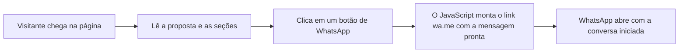
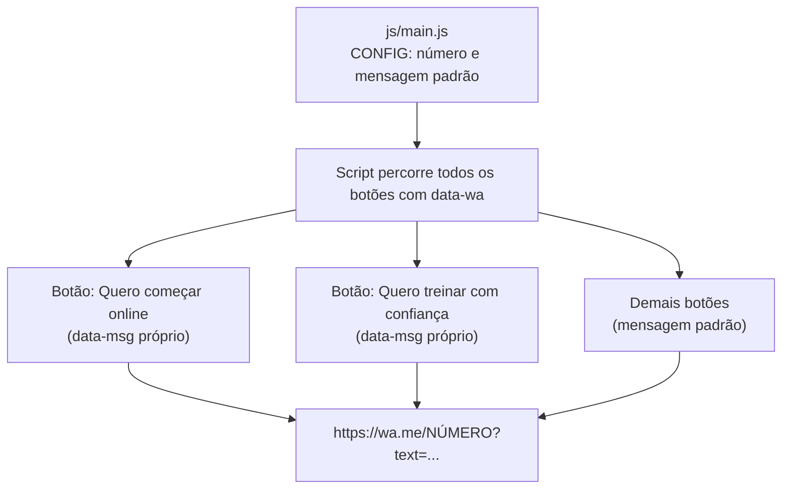
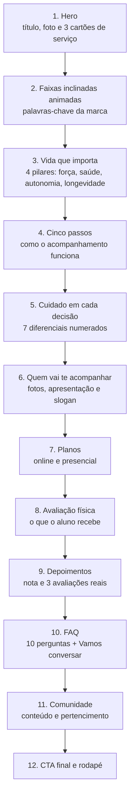
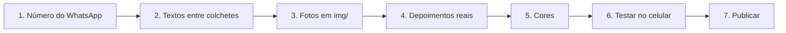

# Landing Page Personal Trainer — Versão 2 (completa)

Landing page completa para personal trainers, feita em **HTML, CSS e JavaScript puros**: sem framework, sem build e sem dependências. Abre direto no navegador e publica em qualquer hospedagem estática, como a Vercel.

Foi pensada como **modelo de venda**: o cliente troca textos, fotos, cores e o número do WhatsApp, e o site está no ar.

**Demonstração:** ´(https://personal-red-kappa.vercel.app/)´

> Existe também a [Versão 1](https://github.com/allancorreaz/personalLP), mais enxuta, em outro repositório.

---

## Destaques

- 12 seções pensadas para conduzir o visitante até o WhatsApp
- Hero com 3 cartões de serviço e faixas inclinadas animadas
- 2 planos com lista do que está incluso
- FAQ interativo com 10 perguntas
- Troca do WhatsApp em **um único lugar**
- Paleta controlada por variáveis CSS, com presets prontos
- Responsivo (celular, tablet e desktop), sem rolagem horizontal
- Sem bibliotecas externas além das fontes do Google Fonts

## Sumário

1. [Como funciona](#como-funciona)
2. [Estrutura do projeto](#estrutura-do-projeto)
3. [Fluxo de seções](#fluxo-de-seções)
4. [Detalhes técnicos](#detalhes-técnicos)
5. [Como personalizar](#como-personalizar)
6. [Como publicar na Vercel](#como-publicar-na-vercel)
7. [Compatibilidade](#compatibilidade-e-boas-práticas)
8. [Conteúdo e direitos](#conteúdo-e-direitos)

---

## Como funciona

O objetivo da página é levar o visitante a **uma única ação**: chamar o personal no WhatsApp.



Todos os botões compartilham o mesmo número, definido em um só lugar. Cada botão pode ter a própria mensagem inicial:



---

## Estrutura do projeto

```text
.
├── index.html        # todo o conteúdo e os ícones SVG embutidos
├── css/
│   └── style.css     # cores (variáveis), layout, animações e responsivo
├── js/
│   └── main.js       # WhatsApp, faixas animadas e ano do rodapé
├── img/              # fotos do cliente
└── README.md
```

| Arquivo | Responsabilidade |
|---|---|
| `index.html` | Todo o conteúdo. Inclui um sprite de ícones SVG, então não há biblioteca de ícones externa. |
| `css/style.css` | Cores por variáveis, tipografia, layout em *grid* e *flexbox*, animação das faixas e regras para celular. |
| `js/main.js` | Monta os links de WhatsApp, duplica o texto das faixas para o movimento ser contínuo e preenche o ano do rodapé. |

---

## Fluxo de seções

A ordem funciona como uma conversa: chamar a atenção, gerar identificação, explicar o método, mostrar as opções, provar com resultados, tirar dúvidas e fechar.



---

## Detalhes técnicos

- **Botões de WhatsApp:** todo elemento com o atributo `data-wa` recebe o link automaticamente. Para uma mensagem diferente em um botão, use `data-msg="Sua mensagem"`.
- **FAQ:** usa `<details>` e `<summary>` nativos do HTML. Funciona com teclado e leitores de tela, sem JavaScript.
- **Faixas animadas:** animação em CSS. Quem tem "reduzir movimento" ativado no sistema operacional vê as faixas paradas (`prefers-reduced-motion`).
- **Espaços de foto:** blocos com a classe `photo` mostram um padrão listrado com um rótulo até a foto real ser colocada.
- **Responsivo:** em telas menores, cartões, passos e planos empilham em uma coluna.

---

## Como personalizar



### 1. WhatsApp

Abra `js/main.js` e edite:

```js
const CONFIG = {
  whatsapp: "5567999999999",   // DDI + DDD + número, só dígitos
  mensagem: "Olá! Vim pelo site e quero saber mais sobre o acompanhamento."
};
```

### 2. Textos

Tudo o que está entre `[COLCHETES]` deve ser substituído:

| Marcador | O que colocar |
|---|---|
| `[SEU NOME]` | Nome do profissional |
| `[CREF 000000-G/UF]` | Registro profissional |
| `[SUA CIDADE – UF]` | Cidade de atendimento presencial |
| `[SUA COMUNIDADE]` | Nome da comunidade de alunos (ou remova a seção) |
| `[SEU SLOGAN]` | Frase da marca |
| `[SEU PÚBLICO]` | Público-alvo (ex.: adultos 35+) |
| `[seu_instagram]` | Perfil do Instagram |

> **Dica:** pesquise por `[` no editor para achar tudo o que falta trocar.

### 3. Fotos

Coloque as imagens (de preferência `.webp`, até ~300 KB cada) na pasta `img/`. No bloco da foto, adicione a imagem e apague o `data-label`:

```html
<!-- antes -->
<div class="photo" data-label="[FOTO]"></div>

<!-- depois -->
<div class="photo" style="--img:url(img/minha-foto.webp)"></div>
```

Blocos de foto: principal (topo), 3 cartões do topo, trio de "Quem vai te acompanhar" e fundo da comunidade.

### 4. Depoimentos

Os depoimentos e a nota do Google vêm como marcadores **de propósito**. Substitua por avaliações **reais** do cliente, com autorização, e coloque o link das avaliações no botão "Ver avaliações no Google".

### 5. Cores

Edite as variáveis no começo de `css/style.css`:

```css
:root{
  --accent:#FF5A1F;            /* destaque: botões e palavras em evidência */
  --accent-ink:#0C1424;        /* texto sobre o destaque */
  --accent-on-light:#C2410C;   /* destaque usado como texto em fundo claro */
  --dark:#0C1424;              /* fundo das seções escuras */
}
```

| Preset | `--accent` | `--accent-on-light` | `--dark` |
|---|---|---|---|
| Laranja (padrão) | `#FF5A1F` | `#C2410C` | `#0C1424` |
| Turquesa | `#19E3C0` | `#0B7A68` | `#0B1A1F` |
| Roxo | `#A78BFA` | `#6D4FD6` | `#120E24` |
| Amarelo | `#FFD21F` | `#8A6A00` | `#111111` |

> **Atenção ao contraste:** `--accent-on-light` existe porque cores vibrantes em texto sobre fundo branco ficam difíceis de ler. Ao trocar o destaque, escolha uma versão mais escura para essa variável.

### 6. Testar

Abra o `index.html` no navegador e confira no celular: número do WhatsApp, CREF, links do rodapé (Política de Privacidade e Termos de Uso) e Instagram.

---

## Como publicar na Vercel

Como o projeto já está na raiz do repositório, não é preciso configurar nada de especial.

1. Acesse [vercel.com/new](https://vercel.com/new) e importe este repositório.
2. Em **Framework Preset**, deixe **Other**. Não há *Build Command* nem *Output Directory*.
3. Clique em **Deploy**.

Cada novo `git push` na branch principal atualiza o site. Para usar o domínio do cliente, vá em *Settings → Domains*.

---

## Compatibilidade e boas práticas

- **Navegadores:** versões atuais de Chrome, Edge, Firefox e Safari. Usa `color-mix()` e máscaras CSS.
- **Fontes:** Sora, Poppins e Kalam, carregadas do Google Fonts (a página precisa de internet na primeira visita).
- **Desempenho:** sem framework. O que mais pesa são as fotos, então otimize-as antes de subir.
- **Acessibilidade:** botões e links reais, ícones decorativos escondidos de leitores de tela e animações desativadas para quem prefere menos movimento.
- **SEO básico:** já traz `title`, `description` e `theme-color`. Ajuste ao nome e à cidade do cliente.

---

## Conteúdo e direitos

- Os **textos são modelos genéricos** e devem ser adaptados à voz e aos serviços de cada profissional.
- **Fotos, nome, CREF, depoimentos e avaliações** pertencem ao cliente. Use somente material dele e com autorização.
- Não publique depoimentos ou notas inventados: além de enganar o visitante, isso pode violar regras do conselho profissional e do consumidor.
- O layout é uma criação própria, sem uso de textos, imagens ou marcas de terceiros.
